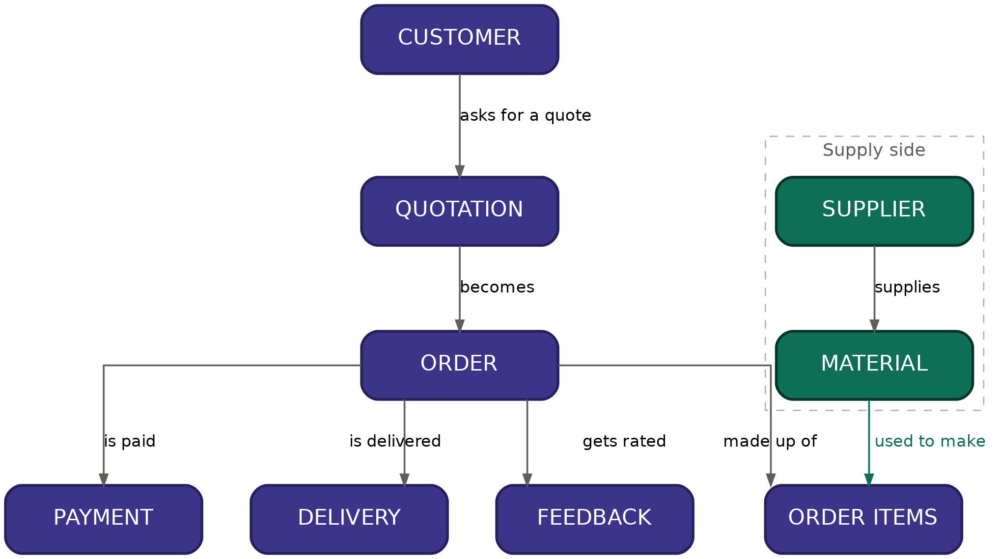
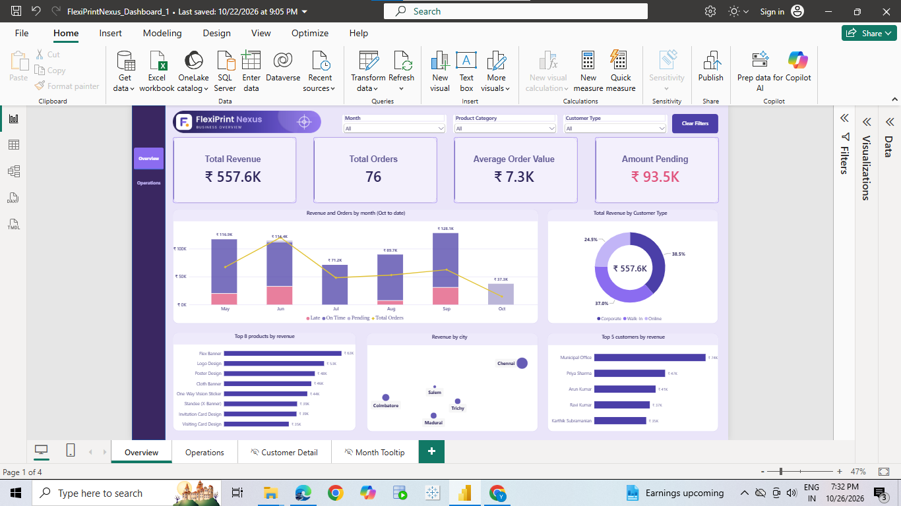
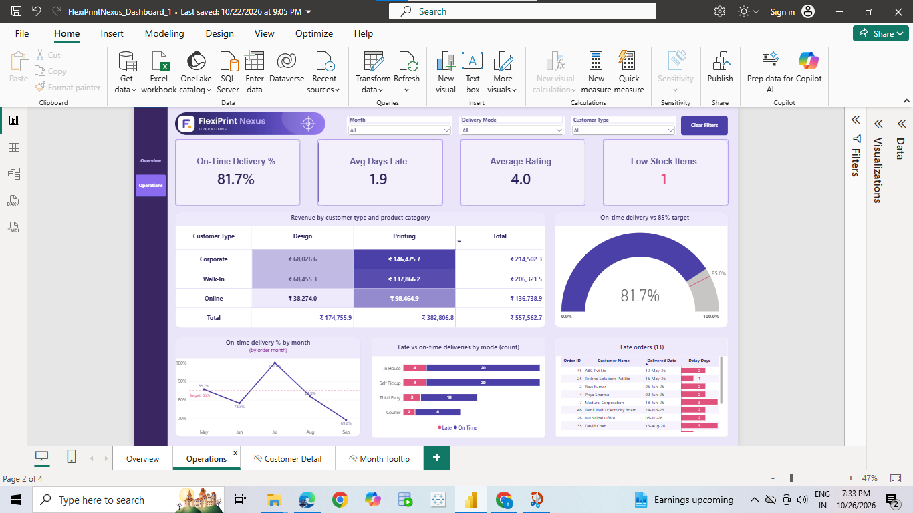
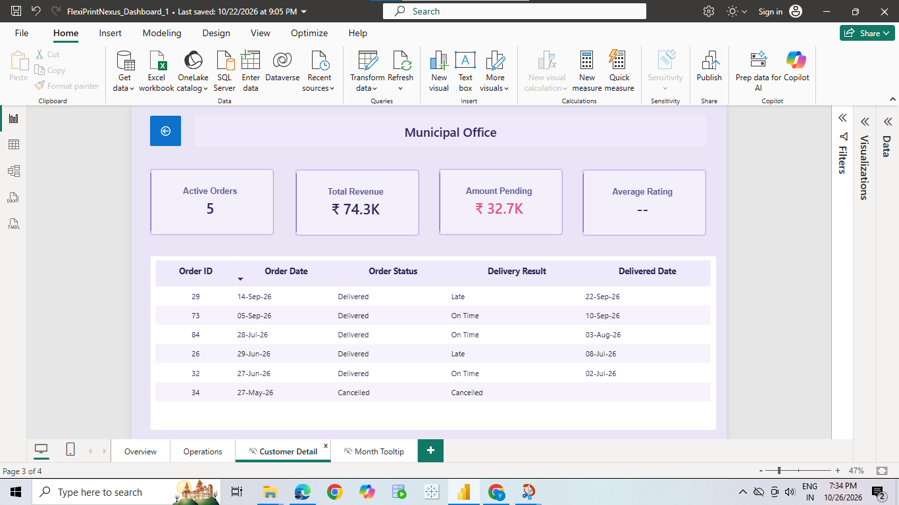
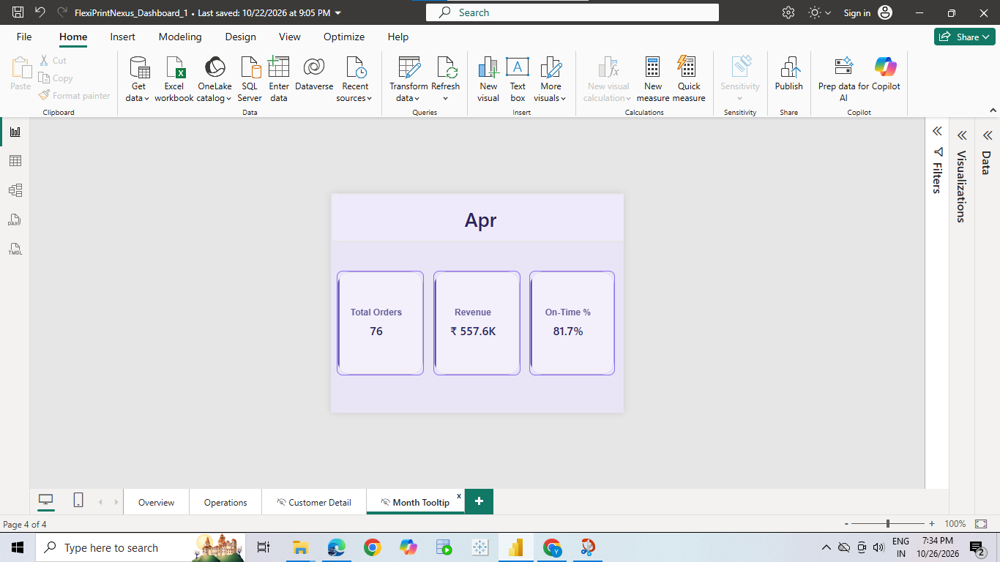

# FlexiPrintNexus — Print & Design Business Database and Power BI Dashboard

## Overview

FlexiPrintNexus is a relational database and Power BI dashboard for a flex/banner printing
and design business (based in Tamil Nadu, India) offering both **printing services** (flex banners,
stickers, signboards, posters, visiting cards) and **design-only services** (logo design,
invitation card design, poster design).

The database models the complete order-to-cash lifecycle: a customer requests a quote, it becomes
a confirmed order, materials and machines are used to fulfil it, the customer pays, the order is
delivered (self pickup, in-house, third party or courier), and the customer leaves feedback.
A two-page Power BI dashboard sits on top of the data to track sales and delivery performance.

## Business Problem

A small print shop tracking customers and orders manually had no structured way to answer basic
business questions: who its most valuable customers are, which products and materials earn the
most, whether deliveries are on time, and how much revenue is still outstanding. This project
models the business as a relational database, answers those questions with SQL, and presents the
results in an interactive dashboard.

## Tools Used

- Oracle SQL Developer
- SQL: schema design (DDL), sample data (DML) and analysis queries (JOINs, GROUP BY, subqueries, window functions)
- Power BI Desktop: data model, DAX measures and a multi-page interactive report
- Tableau: Gantt chart of order delivery performance
  
## Schema (15 tables)

| Table            | Purpose                                                 |
| ---------------- | ------------------------------------------------------- |
| Customers        | Corporate / WalkIn / Online customers                   |
| Employees        | Sales, design, machine operator, delivery, admin staff  |
| Products         | Printing jobs and design-only services                  |
| Materials        | Raw print media (flex, vinyl, cloth, acrylic, etc.)     |
| Machines         | Printers and cutters                                    |
| Suppliers        | Vendors materials are purchased from                    |
| DeliveryPartners | Outside couriers used for non-self-pickup deliveries    |
| Quotations       | Price estimates given before an order is confirmed      |
| Orders           | Confirmed customer orders                               |
| OrderItems       | Line items per order (size, material, machine, price)   |
| Payments         | Payments received against orders (Full/Partial/Pending) |
| PurchaseOrders   | Materials purchased from suppliers                      |
| Deliveries       | How each order reached the customer                     |
| Inventory        | Stock movement history (IN/OUT)                         |
| Feedbacks        | Customer rating and comments after delivery             |

## Tableau Gantt Chart

A Tableau Gantt chart of order delivery performance, built from the SQL data. The workbook and
files are in the `tableau/` folder.

## Power BI Dashboard

The report has two visible pages and two hidden pages that open through interactions.

**Overview page:** total revenue, total orders, average order value and amount pending; revenue and
orders by month; revenue by customer type; top products, cities and customers; slicers for month,
product category and customer type.

**Operations page:** on-time delivery % against an 85% target, average days late, average rating and
low-stock items; a revenue matrix by customer type and product category; on-time % by month; late vs
on-time deliveries by delivery mode; and a list of every late order.

**Customer Detail (hidden drill-through page):** right-click a customer to see their orders, revenue,
pending amount and delivery results.

**Month Tooltip (hidden tooltip page):** hover over a month on the revenue chart to see that month's
orders, revenue and on-time %.

## How to Run

1. Open Oracle SQL Developer and connect to your schema.
2. Run `FlexiPrintNexus_final.sql`: a single script with all table definitions, sample data and
   analysis queries, in dependency order.
   Note: the SQL script builds a 12-order starter dataset. The Power BI dashboard uses an extended dataset of 82 orders (May to October 2026), so its figures will not match the script's output.
4. To explore the dashboard, open `powerbi/FlexiPrintNexus_Dashboard_1.pbix` in Power BI Desktop.

## Key Findings (from the dashboard data, May to October 2026)

- Total revenue is **₹557.6K** across **76 active orders**, with an average order value of **₹7.3K**.
- Printing services bring in about **69%** of revenue and design-only services about **31%**.
- Customer types contribute fairly evenly: Corporate **38.5%**, Walk-in **37.0%**, Online **24.5%**.
- The top customer by spend is **Municipal Office (₹74K)**, ahead of Priya Sharma (₹47K) and Arun Kumar (₹41K).
- **On-time delivery is 81.7%**, below the 85% target. Late orders average **1.9 days** late (13 late orders).
- **Third Party** deliveries have the highest late rate (3 late of 13), while In House and Self Pickup carry the most volume.
- About **₹93.5K** in payments is still outstanding.
- Average customer rating is **4.0**, based on a small number of reviews.

## Skills Demonstrated

- Relational schema design (primary keys, foreign keys, CHECK constraints)
- Populating interlinked tables with realistic sample data
- JOINs (inner, left), GROUP BY, HAVING, CASE WHEN, subqueries
- Window functions: RANK(), ROW_NUMBER() with PARTITION BY, running totals
- Business analysis: revenue trends, customer segmentation, accounts receivable, delivery performance, inventory tracking and customer satisfaction
- Power BI: data modelling, DAX measures, conditional formatting, gauge and matrix visuals, slicers, page navigation, drill-through and report-page tooltips

## Possible Extensions

- A Returns/Reprints table for quality-issue tracking
- Automating OrderItems.Amount with a trigger or computed column
- Publishing the report to the Power BI service for sharing
